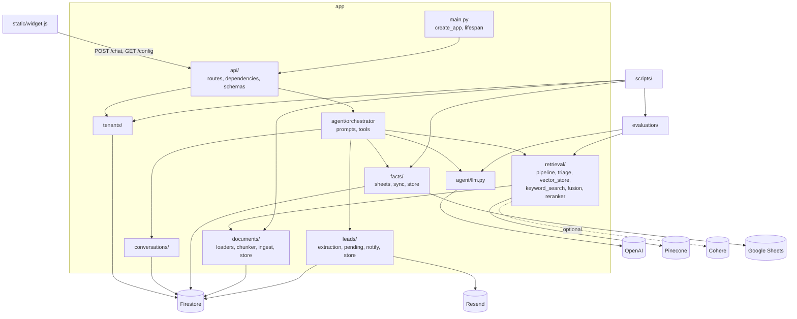

# Code map

Where things live. Update this whenever files are added, moved or removed.

## Modules and key files

### `app/` — the service

| File | Purpose |
|---|---|
| `main.py` | `create_app()` wires stores onto `app.state`, CORS, rate limiter, `/health`, router, `/widget` static mount; `lifespan` builds real Firestore/Pinecone stores only where none were injected |
| `config.py` | All settings (pydantic-settings, `.env`); retrieval flags and their rationale |
| `rate_limit.py` | Shared slowapi `limiter` (own module to avoid a `main` ↔ `routes` import cycle); `client_ip` key from `X-Forwarded-For` (IPv6 grouped by /64), `site_key` key for the per-tenant limit, whose value is `Tenant.rate_limit` or the config default (`routes._tenant_limit`) |
| `request_context.py` | Context vars for request, tenant and conversation id, read by the log formatter; `RequestContextMiddleware` (request id) and `bound()` (tenant, conversation) |
| `logging_setup.py` | Plain or JSON logging, stamping request/tenant/conversation ids on each line |
| `retention.py` | `with_expiry`: stamps `expire_at` on conversation and lead writes for Firestore's TTL deletion |
| `evaluation_config.py` | `RetrievalConfig` (stages, keyword weight, candidates) and the presets the eval compares; `RetrievalConfig.from_settings` is what production runs |

**`app/api/`** — HTTP layer, no prompt or retrieval knowledge
| File | Purpose |
|---|---|
| `internal.py` | `POST /internal/lead-digest` for Cloud Scheduler: checks a Google-signed identity token for `lead_digest_invoker`, runs `send_due_digests`, then `sync_stale_facts` |
| `routes.py` | `GET /config` (public widget settings) and `POST /chat`; maps `LLMError` to 503, schedules `after_reply` as a background task |
| `dependencies.py` | `get_tenant`: site key → tenant (cached), `is_active` check, `Origin` vs `allowed_domains`, sets request context |
| `schemas.py` | `ChatRequest` (validated `conversation_id`), `ChatResponse`, `Action`, `WidgetConfig` |

**`app/agent/`** — what a reply is made of
| File | Purpose |
|---|---|
| `orchestrator.py` | `generate_reply` (contact capture, parallel read + retrieval, prompt assembly, tool loop) and `after_reply` → `persist_turn` (store turn, summarize) then `notify_team_if_due` (lead email) |
| `prompts.py` | System prompt (incl. scope and "instructions only from here" rules), facts message, retrieved-context message, running-summary prompt, lead-email summary prompt |
| `sanitize.py` | `strip_invisible`: removes invisible Unicode from visitor messages (hidden instructions); `instruction_like`: flags text addressed to a model, used by the facts sheet reader and ingest |
| `tools.py` | Tool schemas: `contact_team`, `record_visitor_details` (worded per tenant: `tool_schemas(tenant)`) |
| `questions.py` | `is_visitor_question`: which messages are recorded as questions for the lead email (no model call; errs towards including) |
| `llm.py` | The only OpenAI chat access; `complete`, `complete_with_tools`, `LLMError` |

**`app/retrieval/`** — finding relevant chunks
| File | Purpose |
|---|---|
| `pipeline.py` | `retrieve(..., config=None, programmes=None)`: embed → vector search → optional BM25 + RRF → optional rerank; with `programmes`, `blend` puts the focused programmes' sections first. The one retrieval path, used by production and the eval |
| `triage.py` | `needs_retrieval`: skips retrieval for "hi", "thanks" and similar |
| `embeddings.py` | OpenAI embeddings for queries and chunks |
| `vector_store.py` | `VectorStore` ABC, in-memory and Pinecone (namespace per tenant) |
| `keyword_search.py` | BM25 over a tenant's chunks (off by default) |
| `fusion.py` | Weighted Reciprocal Rank Fusion |
| `reranker.py` | Cohere rerank (off by default) |

**`app/documents/`** — ingestion
| File | Purpose |
|---|---|
| `loaders.py` | Reads supported text files into title + text |
| `chunker.py` | Heading-aware Markdown chunking |
| `ingest.py` | Loader → chunker → chunk store; stable document ids, re-ingest replaces |
| `models.py` / `store.py` | `Document`, `Chunk`; `ChunkStore` (in-memory, Firestore) |

**`app/facts/`** — exact, changeable details (prices, dates)
| File | Purpose |
|---|---|
| `sheets.py` | Reads and validates facts from a tenant's Google Sheet |
| `sync.py` | Sheet → fact store, with a diff of what changed; `sync_stale_facts` (the scheduled sync: day-old facts, a few tenants per sweep, an emptied sheet held) |
| `models.py` / `store.py` | `Fact`, `FactSheet`; `FactStore` (in-memory, Firestore) plus `get_cached_facts` |

**`app/feedback/`** — thumbs up/down on replies
| File | Purpose |
|---|---|
| `models.py` | `Feedback` (tenant, conversation, reply id, rating, reason) |
| `store.py` | `FeedbackStore`: one record per reply in `feedback`, ids only (the reply is stored in the background, so its text is looked up later by `scripts/feedback.py`) |

**`app/usage/`** — the daily token budget
| File | Purpose |
|---|---|
| `store.py` | `UsageStore`: tokens per tenant per UTC day (`token_usage` collection, server-side increment) |
| `budget.py` | `over_budget` (checked before a reply; read cached a minute; fails open) and `record` (after it); budget is `Tenant.daily_token_budget` or `daily_token_budget` |

**`app/leads/`** — lead capture
| File | Purpose |
|---|---|
| `extraction.py` | Pulls email/phone out of a message and redacts them |
| `pending.py` | `PendingItem` and `ItemKind` (`CONTACT_REQUEST`, and `UNANSWERED` on older leads), the things that trigger emails |
| `notify.py` | Formats and sends the lead email through Resend (plain text plus HTML) to the team only, Reply-To the visitor (never to/cc: anyone can type anyone's address); the summary arrives as text from the orchestrator |
| `links.py` | `defang`: links in visitor-written text shown unclickable in the lead email, plus the caution note |
| `reply_draft.py` | The suggested reply in the lead email: a template (thanks, questions still needing an answer with a gap under each, never answers) and the `mailto:` link that opens it |
| `email_html.py` | `render_lead_email`: the HTML lead email, sectioned boxes in table layout with inline styles, all visitor and model text escaped; a Suggested reply section and a Reply button that opens it |
| `models.py` / `store.py` | `Lead`; `LeadStore` (in-memory, Firestore): field merge, add item, mark items sent |

**`app/programmes/`** — `models.py`: `Programme`, `ProgrammeCatalogue` (`programme_for` a section), `load_catalogue` (reads `docs/<tenant>/programmes.yaml`); `store.py`: Firestore/in-memory store, cached; `focus.py`: `resolve_focus` (which programmes a message is about, given the earlier focus), `is_comparing`, `search_text`.

**`app/documents/sections.py`** — section keys (`doc | Heading > Sub`) and label matching, shared by ingest tagging and the evaluation.

**`app/tenants/`, `app/conversations/`** — `models.py` + `store.py` each: `Tenant` (with `Wording`, how the bot describes the business; defaults are a yoga school's) / `TenantStore`; `Conversation`, `Message`, `Question` / `ConversationStore` (append turn, recording the question in the same write; `apply_summary` drops only the summarized messages, transactionally, and never touches `questions`; `mark_questions_emailed`).

### Outside `app/`

| Path | Purpose |
|---|---|
| `static/widget.js` | Embeddable shadow-DOM widget; calls `/config` and `/chat` with `X-Site-Key`; renders output as text only; shows each reply as a run of bubbles, one per paragraph (`splitReply`, `showReply`); a "Talk to the team" button after the first reply sends a contact request as a visitor message; the launcher ("Chat with us") teases up to 3 short suggested questions (`startTeaser`) |
| `static/test-page.html` | Local page hosting the widget |
| `evaluation/` | Eval harness: `questions.py` (labelled set), `metrics.py`, `run.py` (calls `retrieval.pipeline.retrieve` per config), `faithfulness.py` (LLM judge), `attacks.py` (misuse attempts and their checks, for `scripts.evaluate_attacks`), `history.py` (saved runs) |
| `scripts/` | Ops CLIs run as `python -m scripts.<name>` against real services (see CLAUDE.md), including `delete_tenant` (a tenant or one conversation, Firestore and Pinecone; dry run by default); `unanswered` (questions labelled not / partly answered, from `Conversation.questions`); `feedback` (thumbs up/down counts and every thumbs-down with its question and reply); `rename_tenant` (copies a tenant's record and visitor data to a new id; documents and facts are rebuilt by ingest and sync); `leads` (every lead as a CSV file for Excel or Google Sheets, via `LeadStore.since`); `smoke_test` (post-deploy check of `/health` and `/config`); `test_eval_metrics.py` is a pytest file |
| `tests/` | pytest suite, in-memory stores and mocked LLM/embeddings; `test_failure_injection.py` (dependency failures, known gaps as strict xfails), `test_llm_limits.py` (timeouts, retries, reply deadline, token cap), `test_cloudbuild.py` (deploy pipeline guards), `test_log_context.py` (ids on every log line), `test_size_limits.py` (conversation and detail caps), `test_attack_checks.py` (the attack eval's deterministic checks), `test_sanitize.py`, `test_sentry_privacy.py`, `test_token_budget.py`, `test_content_screening.py`, `test_retention.py`, `test_lead_email_links.py`, `test_feedback.py`, `test_wording.py`, `test_leads_export.py`, `test_judge_model.py`, `test_rename_tenant.py` |
| `tests/browser/` | Playwright end-to-end tests of the real widget against the app on a local port (skipped without Playwright) |
| `ruff.toml`, `mypy.ini` | Lint and type-check settings for CI |
| `requirements.txt`, `requirements-dev.txt` | What the service needs (the image); plus pytest for CI and Cloud Build |
| `Dockerfile`, `cloudbuild.yaml` | Tests, then image build and Cloud Run deploy with Secret Manager secrets (a failing test stops the deploy) |
| `.github/workflows/tests.yml` | CI: pytest on Python 3.12 |
| `notes/` | Project notes: this file, architecture record, refactor plan, `backlog.md` (numbered to-do list, with status), `code-review-2026-10-16.md` (code and infrastructure review, findings H1–M8), `install-guide.md` (widget install steps for customers), `lead-digest-setup.md` (Cloud Scheduler setup for the lead digest), `retention-setup.md` (Firestore TTL for conversations and leads), `runtime-sa-setup.md` (the service's own account and its roles), `kt/` (HTML knowledge-transfer course on the whole project, phases 0 to 10, with 4a to 4f file by file; phase 10 is setup for someone given the folder) |

## A chat request, end to end

1. **Widget** (`static/widget.js`) POSTs `{message, conversation_id}` to `/chat` with `X-Site-Key`.
2. **slowapi** rate-limits per visitor IP and per tenant site key (`rate_limit.py`, limits and `trusted_proxy_hops` from `config.py`).
3. **`get_tenant`** (`api/dependencies.py`) resolves the tenant, rejects inactive tenants and disallowed `Origin`s.
4. **`chat`** (`api/routes.py`) assigns a conversation id if missing and calls `generate_reply` with the stores from `app.state`.
5. **`generate_reply`** (`agent/orchestrator.py`):
   1. `extract_contact` strips email/phone into the lead store.
   2. Programme focus (`programmes.focus.resolve_focus`, saved with `ConversationStore.set_focus` when it changes), then `ConversationStore.get` and, if `needs_retrieval`, `retrieval.pipeline.retrieve` with the focus (embed → Pinecone in the tenant's namespace; blended). In parallel when the message names its programme; otherwise retrieval waits for the stored focus.
   3. Builds messages: system prompt → summary → facts → "ask for email" nudge (unsent pending items, no contact) → retrieved context → history → user message.
   4. Tool loop (max 3) via `llm.complete_with_tools`. `contact_team` adds a `CONTACT_REQUEST` item and tells the bot the request was passed on (or to ask for an email, or to give contact details if email is not set up); it sends nothing; `record_visitor_details` only writes lead fields.
6. **Response** returns `reply` and `conversation_id` (no sources; retrieved chunk ids are logged by `pipeline.retrieve`). An `LLMError` becomes a 503.
7. **Background** (`after_reply`): `persist_turn` appends the turn and, past `summarize_trigger`, summarizes older messages with `llm.complete`. Then `notify_team_if_due`: if the lead has contact details and an unsent `CONTACT_REQUEST`, and `notify.can_send`, it takes the questions recorded since the last email (`Conversation.questions[questions_emailed:]`), and one JSON call summarises the conversation and labels each question by id (`_compose_for_team`, `_parse_for_team`; any the model drops stay in as "unchecked"); then it calls `notify.send_lead_email`, marks just those items sent, and advances `questions_emailed`. A failed send marks them failed (no retry), or with `retry_failed_lead_emails` on leaves them for the next turn. Within `lead_email_cooldown_minutes` of the last email, a request with no new questions is marked sent without emailing or a model call.

## Dependencies between modules

- `api` → `agent`, `tenants`, `rate_limit`, `request_context`. Nothing in `app` imports `api` except `main`.
- `agent.orchestrator` is the hub: → `retrieval`, `conversations`, `facts`, `leads`, `tenants`, `request_context`, `agent.prompts/tools/llm`.
- `leads` depends on nothing in `agent`: the lead-email summary is written in `agent.orchestrator` and passed to `leads.notify` as text.
- `retrieval` → `documents` (models, chunk store for BM25). `documents` depends on nothing else in `app`.
- `facts`, `tenants`, `conversations` are leaves (only `config`).
- `config` is imported everywhere; `main` is the only place that constructs cloud-backed stores for the server.
- `evaluation` → `retrieval`, `agent.llm`, `evaluation_config`. `scripts` → domain stores, `documents.ingest`, `facts.sync`, `evaluation`.

## Structure

